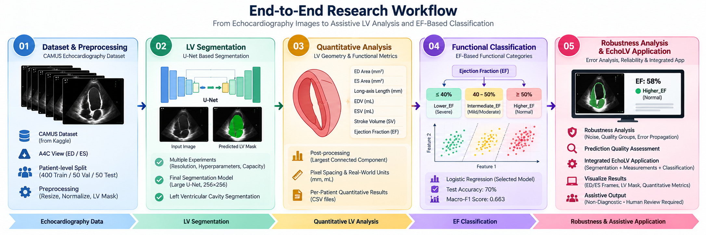
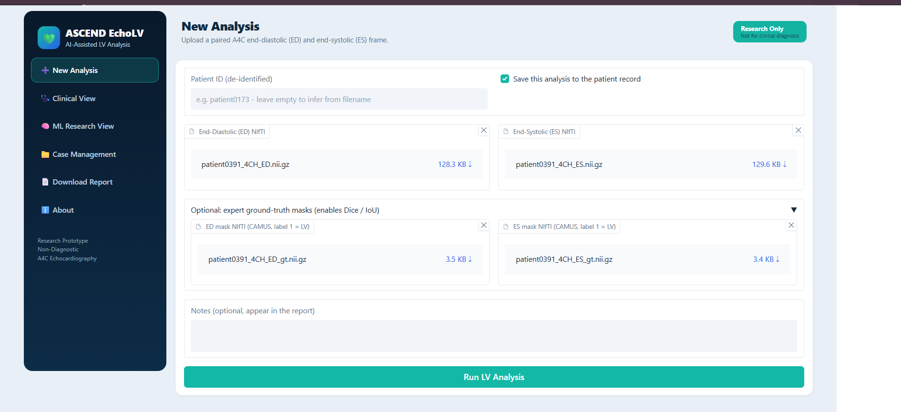
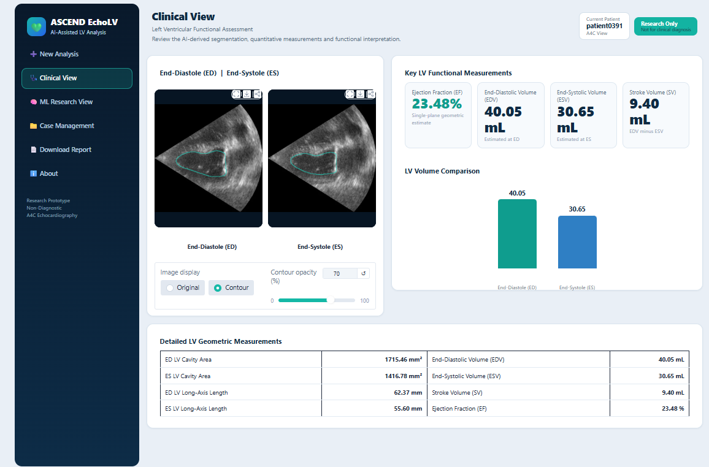
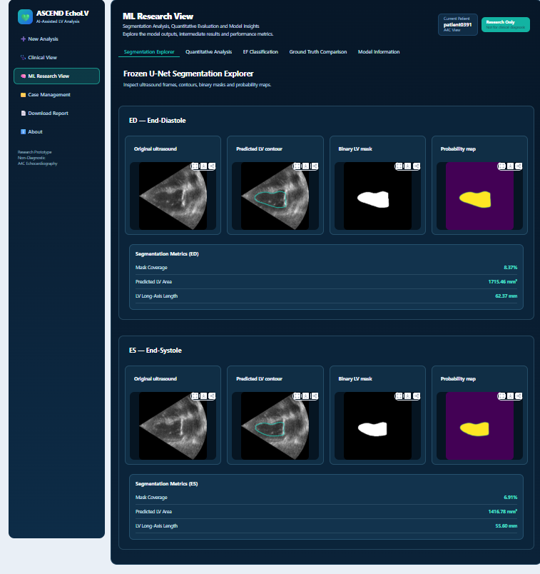
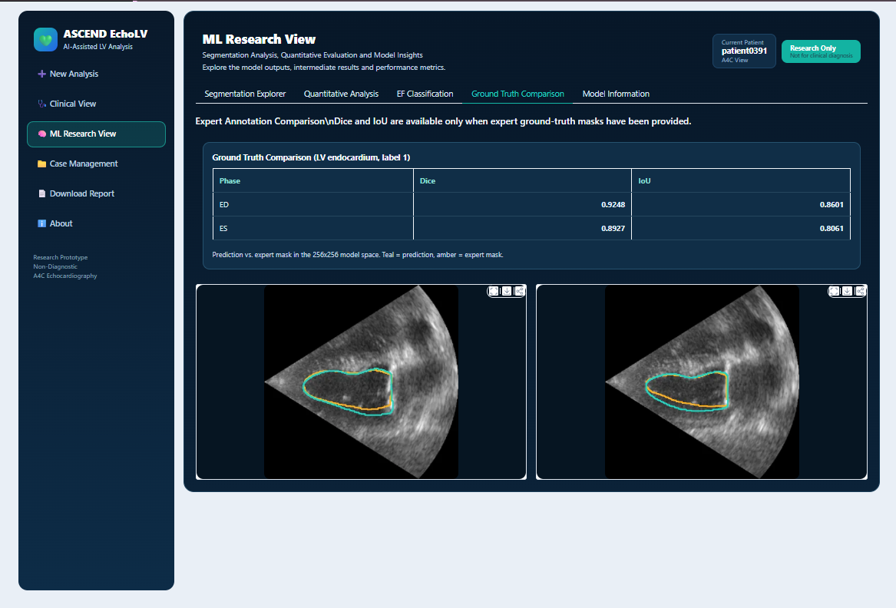
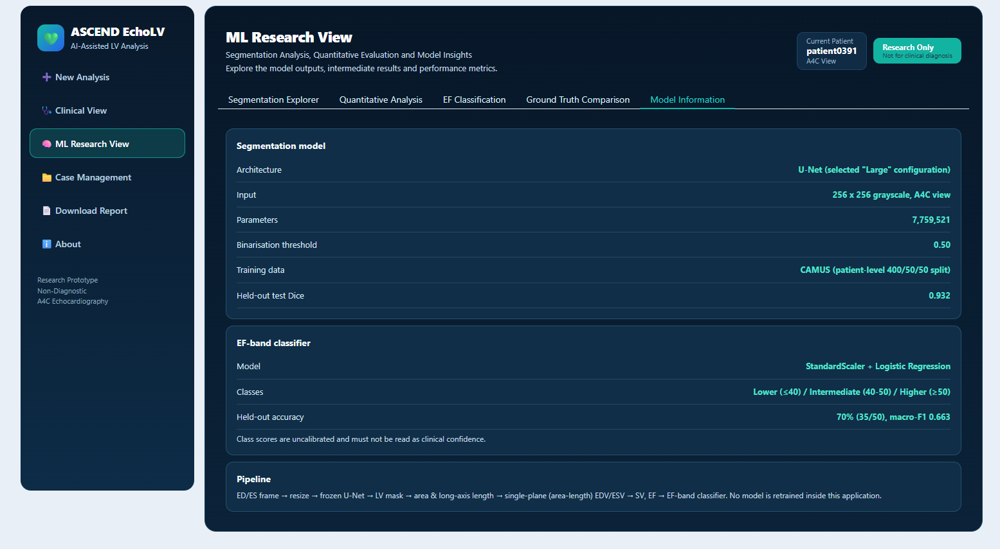

<div align="center">

# CAMUS-LV-Research

### Computer Vision-Based Assistive Application for Left Ventricular Analysis Using A4C Echocardiography

**ASCEND EchoLV · Computer Vision · Deep Learning · Medical Image Analysis**

**ASCEND Lab | National University of Sciences and Technology (NUST), Pakistan**

*Research Supervisor: Dr. M. Raza Ali*

</div>

---

> [!IMPORTANT]
> **Research and educational use only.** ASCEND EchoLV is a completed, non-diagnostic research prototype. It has not undergone clinical validation and must not be used for medical diagnosis, treatment, or patient-care decisions.

## Overview

**CAMUS-LV-Research** presents an end-to-end computer vision research pipeline for analyzing the left ventricle (LV) in two-dimensional echocardiography.

The project uses paired **end-diastolic (ED)** and **end-systolic (ES)** frames from the **apical four-chamber (A4C)** view to investigate:

- Deep learning-based LV cavity segmentation.
- Quantitative cardiac geometry and volume estimation.
- Ejection fraction (EF) estimation and functional classification.
- Segmentation error propagation and model reliability.
- Integration into the completed **ASCEND EchoLV** assistive application.

### Research motivation

A central question motivated this research:

> **Does achieving a high segmentation Dice score necessarily guarantee accurate ventricular measurements, ejection fraction estimates, and functional classification?**

The experimental findings demonstrate why segmentation quality must be evaluated beyond pixel-level overlap. In particular, segmentation inaccuracies can propagate into ventricular volume calculations and EF-based classification.

The project therefore evaluates the complete pipeline rather than optimizing segmentation accuracy in isolation.

## End-to-End Research Workflow



*Figure 1. End-to-end research workflow from CAMUS A4C echocardiographic images through LV segmentation, quantitative analysis, EF-based classification, robustness evaluation, and the ASCEND EchoLV application.*

### Research phases

| Phase | Component | Main Objective |
|:---:|---|---|
| **01** | LV Segmentation | Develop, compare, and freeze a U-Net segmentation model |
| **02** | Quantitative LV Analysis | Estimate LV geometry, EDV, ESV, SV, and EF |
| **03** | Functional Classification | Evaluate EF-based classification approaches |
| **04** | Robustness and Error Analysis | Investigate error propagation, confidence, image quality, and failure cases |
| **05** | ASCEND EchoLV Application | Integrate and verify the completed assistive research prototype |

---

## Dataset and Experimental Protocol

### CAMUS Dataset

The project uses the **CAMUS (Cardiac Acquisitions for Multi-structure Ultrasound Segmentation)** dataset, which contains echocardiographic acquisitions from 500 patients.

The original CAMUS dataset provides apical two-chamber and four-chamber views, together with expert cardiac-structure annotations.

This research focuses on the **A4C view**, using ED and ES frames for LV cavity segmentation and subsequent analysis.

**Original dataset:** [Official CAMUS Project](https://www.creatis.insa-lyon.fr/Challenge/camus/)

**Dataset download source used:** [CAMUS-Human Heart Data — Kaggle](https://www.kaggle.com/datasets/shoybhasan/camus-human-heart-data)

### Experimental configuration

| Parameter | Configuration |
|---|---|
| Dataset | CAMUS |
| Cardiac view | A4C / 4CH |
| Cardiac phases | End-diastole and end-systole |
| Segmentation target | LV cavity, CAMUS label 1 |
| Training patients | 400 |
| Validation patients | 50 |
| Evaluation patients | 50 |
| Random seed | 42 |
| Segmentation framework | TensorFlow / Keras |
| Main environment | Python, Google Colab |

The **400/50/50 patient-level split** is project-specific and differs from the original CAMUS challenge split.

Patient-level separation was maintained across the controlled experiments. The evaluation partition had some historical pilot exposure during earlier development, so results should not be described as coming from a completely untouched external test cohort.

The raw CAMUS dataset is not redistributed in this repository.

**Dataset splits:** [CAMUS_FINAL/splits](CAMUS_FINAL/splits/)

---

# Research Methodology and Experimental Results

## Phase 1 — Left Ventricular Segmentation

**Objective:** Develop and evaluate a deep learning model for segmenting the LV cavity from A4C ED and ES echocardiographic frames.

A U-Net-based segmentation pipeline was developed using grayscale echocardiographic images and expert LV annotations.

### Data preprocessing

The segmentation pipeline includes:

- NIfTI image and mask loading.
- Extraction of A4C ED and ES frames.
- Image resizing and intensity normalization.
- Binary LV cavity mask extraction.
- Patient-level dataset separation.
- Model training, validation, and segmentation evaluation.

### Controlled experimental stages

| Subphase | Investigation | Configurations |
|---|---|---|
| **1A** | Image resolution | 128×128, 256×256, 512×512 |
| **1B** | Hyperparameters | Learning rate, optimizer, batch size |
| **1C** | Network capacity | Small, Medium, and Large U-Net |
| **1D** | Loss functions | BCE+Dice, Focal+Dice, Tversky |
| **1E** | Final segmentation evaluation | Controlled downstream-sensitive evaluation |
| **1F** | Model finalization | Frozen model and inference verification |

### Model capacity comparison

| Architecture | Approximate Parameters |
|---|---:|
| Small U-Net | 0.49 million |
| Medium U-Net | 1.94 million |
| Large U-Net | 7.76 million |

The experimental investigation examined the trade-offs between segmentation performance, network capacity, and computational requirements.

After downstream measurements revealed sensitivity to segmentation errors, the segmentation stage was revisited and the selected model was prepared for frozen inference.

### Final segmentation model

| Property | Final Configuration |
|---|---|
| Architecture | Large U-Net |
| Parameters | 7,759,521 |
| Input resolution | 256×256 |
| Input type | Grayscale A4C ED/ES frames |
| Optimizer | Adam |
| Learning rate | 0.0001 |
| Loss | Binary Cross-Entropy + Dice |
| Output activation | Sigmoid |
| Mask threshold | 0.50 |

### Final segmentation evaluation

| Metric | ED | ES | Overall |
|---|---:|---:|---:|
| Dice | **0.9396** | **0.9189** | **0.9292** |
| IoU | **0.8870** | **0.8529** | **0.8700** |
| LV area relative MAE | 6.88% | 9.48% | — |

Evaluation was conducted on **100 frames from 50 patients**, consisting of one ED and one ES frame per patient.

The final evaluation records report an overall Dice of **0.9292**. Some application model-information screens display approximately **0.932**; the numerical table above follows the final evaluation summary.

### Main findings

- The final model achieved strong overall LV segmentation overlap.
- ES segmentation was less accurate than ED segmentation.
- ES LV area error was higher than ED LV area error.
- These differences motivated downstream investigation of volume and EF estimation errors.

**Explore Phase 1:** [Segmentation Experiments](CAMUS_FINAL/phase1_segmentation/)

<details>
<summary><strong>Explore Phase 1 subphases</strong></summary>

- [Phase 1A — Resolution](CAMUS_FINAL/phase1_segmentation/phase1A_resolution/)
- [Phase 1B — Hyperparameters](CAMUS_FINAL/phase1_segmentation/phase1B_hyperparameters/)
- [Phase 1C — Capacity](CAMUS_FINAL/phase1_segmentation/phase1C_capacity/)
- [Phase 1D — Loss](CAMUS_FINAL/phase1_segmentation/phase1D_loss/)
- [Phase 1E — Final Validation](CAMUS_FINAL/phase1_segmentation/phase1E_final_validation/)
- [Phase 1F — Frozen Model](CAMUS_FINAL/phase1_segmentation/phase1F_final_model/)

</details>

---

## Phase 2 — Quantitative Left Ventricular Analysis

**Objective:** Convert predicted LV segmentation masks into geometric and functional measurements, then investigate their accuracy.

Phase 2 extends segmentation beyond pixel-level overlap by extracting clinically relevant geometric quantities for research analysis.

### Quantitative measurements

| Measurement | Description |
|---|---|
| ED Area | LV cavity area at end-diastole |
| ES Area | LV cavity area at end-systole |
| Long-Axis Length | Estimated LV longitudinal dimension |
| EDV | End-diastolic volume |
| ESV | End-systolic volume |
| SV | Stroke volume |
| EF | Ejection fraction |

The analysis uses image-spacing information and a single-plane geometric approximation to derive ventricular volumes.

### Derived measurements

Stroke volume:

$$
SV = EDV - ESV
$$

Ejection fraction:

$$
EF(\%) = \frac{EDV - ESV}{EDV} \times 100
$$

These are **single-plane A4C geometric estimates**, not biplane Simpson measurements or independently validated clinical volumes.

### Final quantitative evaluation

| Measurement | Mean Absolute Error | Pearson Correlation |
|---|---:|---:|
| EDV | **11.405 mL** | 0.9182 |
| ESV | **7.176 mL** | 0.9070 |
| SV | **7.933 mL** | 0.8761 |
| EF: GT-mask vs predicted-mask geometry | **5.894 pp** | 0.8474 |
| EF: CAMUS reference vs predicted-mask geometry | **8.191 pp** | 0.7083 |

*pp = percentage points; GT = ground truth.*

### EF error decomposition

A key investigation separated different sources of EF disagreement.

| Comparison | EF MAE |
|---|---:|
| CAMUS reference EF vs ground-truth-mask geometry | **6.668 pp** |
| Ground-truth-mask geometry vs predicted-mask geometry | **5.894 pp** |
| CAMUS reference EF vs predicted-mask geometry | **8.191 pp** |

These errors are not additive because the individual discrepancies may have different directions.

### Main findings

- Predicted-mask geometry showed strong correlations with reference-mask-derived ventricular volumes.
- EF estimation was less strongly correlated with CAMUS reference EF than EDV and ESV were with their corresponding reference-mask-derived estimates.
- Segmentation inaccuracies contributed to EF disagreement.
- The single-plane geometric estimation method also introduced disagreement, even when expert masks were used.
- Therefore, **segmentation is an important contributor to downstream error, but it is not the only source**.

**Explore Phase 2:** [Quantitative LV Analysis](CAMUS_FINAL/phase2_quantitative/)

---

## Phase 3 — EF-Based Functional Classification

**Objective:** Investigate whether quantitative LV measurements can support automated classification into research-defined EF categories.

### EF categories

| Category | EF Range |
|---|---|
| **Lower EF** | EF ≤ 40% |
| **Intermediate EF** | 40% < EF < 50% |
| **Higher EF** | EF ≥ 50% |

These categories are research labels and do not represent independent clinical diagnoses.

### Classification approaches

Two main approaches were evaluated:

**Direct Geometry Baseline**

A direct classification approach based on the EF estimated from predicted LV geometry.

**Learned Classifier**

A machine-learning pipeline using:

- StandardScaler.
- Logistic Regression.
- Quantitative LV features derived from the segmentation pipeline.

The selected classifier used eight features:

1. ED LV area.
2. ES LV area.
3. ED long-axis length.
4. ES long-axis length.
5. EDV.
6. ESV.
7. SV.
8. EF.

### Final classification comparison

| Metric | Direct Baseline | Learned Classifier |
|---|---:|---:|
| Accuracy | 66.0% | **70.0%** |
| Balanced Accuracy | 62.7% | **67.3%** |
| Macro-F1 | 0.624 | **0.663** |
| Weighted F1 | 0.646 | **0.686** |

The learned classifier achieved **35 correct predictions out of 50 evaluation patients**.

### Per-class performance

| EF Category | Correct / Total | Recall |
|---|---:|---:|
| Lower EF | 13 / 16 | 81.3% |
| Intermediate EF | 5 / 14 | 35.7% |
| Higher EF | 17 / 20 | 85.0% |

### Main findings

- The learned classifier improved accuracy by **4 percentage points** over the direct geometry baseline.
- Macro-F1 improved from **0.624 to 0.663**.
- The intermediate EF category remained the most difficult to classify.
- Most misclassifications occurred between neighboring EF categories.
- Classification performance remained sensitive to errors in the upstream measurement pipeline.

The results demonstrate the potential of quantitative LV features for functional classification while highlighting important reliability limitations.

**Explore Phase 3:** [EF-Based Classification](CAMUS_FINAL/phase3_classification/)

---

## Phase 4 — Robustness, Error Propagation, and Reliability

**Objective:** Investigate the reliability of the frozen pipeline by analyzing segmentation error propagation, classification confidence, image quality, and representative success and failure cases.

### Phase 4A — Error Propagation

The analysis examined relationships between segmentation errors and derived ventricular measurement errors.

| Relationship | Spearman Correlation |
|---|---:|
| ED area error vs EDV error | **0.723** |
| ES area error vs ESV error | **0.858** |
| ED Dice vs EDV error | **−0.612** |
| ES Dice vs ESV error | **−0.706** |

The results showed strong associations between segmentation accuracy and ventricular measurement error, particularly for ES area and ESV.

The median segmentation-induced EF error was:

| Classification Outcome | Median EF Error |
|---|---:|
| Correct classifications | **3.23 pp** |
| Misclassifications | **8.92 pp** |

These are exploratory associations and do not establish that segmentation error caused every classification mistake.

### Phase 4B — Confidence and Uncertainty

The analysis investigated whether classifier scores were reliable indicators of prediction correctness.

| Metric | Correct Predictions | Incorrect Predictions |
|---|---:|---:|
| Median confidence | 0.708 | 0.661 |
| Median confidence margin | 0.428 | 0.350 |
| Median normalized entropy | 0.594 | 0.668 |

An incorrect prediction occurred with a maximum class score of **0.888**.

The correlation between classifier confidence and absolute end-to-end EF error was approximately **0.040**.

**Finding:** High classifier scores do not necessarily indicate reliable ventricular measurements or correct functional classification. The scores were not calibrated probabilities of correctness.

### Phase 4C — Image Quality Subgroup Analysis

The evaluation compared CAMUS Good, Medium, and Poor image-quality groups.

| Image Quality | Patients | Misclassified | Misclassification Rate |
|---|---:|---:|---:|
| Good | 30 | 6 | **20.0%** |
| Medium | 13 | 6 | **46.2%** |
| Poor | 7 | 3 | **42.9%** |
| **Total** | **50** | **15** | **30.0%** |

Additional findings included:

- Median ED Dice decreased from **0.9519** in Good-quality cases to **0.9130** in Poor-quality cases.
- Median segmentation-induced EF error increased from **3.64 pp** in Good-quality cases to **9.09 pp** in Poor-quality cases.
- Medium-quality cases exhibited particularly challenging ESV and ES-area errors.
- Performance degradation was not uniformly monotonic across image-quality groups.

These subgroup analyses are exploratory. The Poor-quality group contained only seven patients, limiting the strength of conclusions.

### Phase 4D — Representative Failure Case Analysis

Representative cases were selected using predefined quantitative criteria rather than visual appearance alone.

The analysis investigated:

- Large segmentation-associated EF errors.
- High-confidence misclassifications.
- Large end-to-end EF disagreements.
- Errors near EF classification boundaries.
- Representative successful predictions.

The case studies showed that different prediction failures can arise from different sources, including segmentation inaccuracies, geometric estimation assumptions, and category-boundary sensitivity.

Historical masks were regenerated from the frozen segmentation model for qualitative visualization. Original frozen quantitative evaluation records remained the source of reported metrics.

### Phase 4 conclusions

The robustness analysis reinforced three important observations:

1. Strong segmentation overlap does not guarantee accurate downstream functional estimates.
2. Image quality and geometric measurement errors can influence prediction reliability.
3. Model confidence alone is insufficient to establish patient-level reliability.

**Explore Phase 4:** [Robustness and Error Analysis](CAMUS_FINAL/phase4_robustness/)

---

## Key Research Findings

The combined experimental results support the following conclusions:

**1. Segmentation overlap is only one part of end-to-end performance.**

The final model achieved strong segmentation Dice, but EF estimation and classification remained less reliable.

**2. End-systolic errors deserve particular attention.**

ES segmentation and area errors were higher than ED errors, and ES area error showed a strong association with ESV error.

**3. EF disagreement has multiple sources.**

Both predicted-mask segmentation errors and the single-plane geometric estimation method contributed to EF disagreement.

**4. Learned classification offered a modest improvement.**

The selected classifier improved accuracy from 66% to 70%, although intermediate EF classification remained difficult.

**5. Confidence does not guarantee correctness.**

High classifier scores could occur even for incorrect predictions.

**6. Image quality affects different pipeline stages differently.**

Good-quality images generally performed better, but Medium and Poor cases showed different error patterns across segmentation, measurements, and classification.

Together, these findings motivate a reliability-aware, assistive interpretation of automated LV analysis rather than reliance on a single accuracy metric.

---

## Phase 5 — ASCEND EchoLV Assistive Application

**Status: Completed research prototype, including integration and verification.**

ASCEND EchoLV integrates the frozen segmentation and classification pipeline into an interactive application for LV analysis using paired A4C ED and ES frames.

The application is intended for research demonstration, quantitative analysis, visualization, and experimental evaluation.

### Application capabilities

| Module | Functionality |
|---|---|
| New Analysis | Upload ED/ES NIfTI images, optional expert masks, and case details |
| Clinical View | Visualize LV contours and quantitative cardiac measurements |
| Segmentation Explorer | Inspect original frames, binary masks, probability maps, and contours |
| Quantitative Analysis | Examine LV areas, lengths, volumes, SV, and EF |
| EF Classification | View geometry-derived and learned EF-band outputs |
| Ground Truth Comparison | Compare predicted and expert LV masks using Dice and IoU |
| Model Information | Inspect segmentation architecture, classifier details, and evaluation results |
| Case Management | Save, reopen, review, and compare analysis cases |
| Reporting | Export research reports as PDF and case data as CSV |

### Application screenshots

<details open>
<summary><strong>New Analysis — Input and Case Configuration</strong></summary>



The application accepts paired A4C ED and ES images, with optional expert segmentation masks for quantitative comparison.

</details>

<details>
<summary><strong>Clinical View — LV Measurements and Visualization</strong></summary>



The interface displays predicted LV contours and estimated EDV, ESV, stroke volume, ejection fraction, area, and long-axis length.

The term "Clinical View" refers to the application interface and does not imply clinical validation.

</details>

<details>
<summary><strong>ML Research View — Segmentation Explorer</strong></summary>



The research interface supports inspection of echocardiographic frames, predicted masks, probability maps, and LV contour overlays.

</details>

<details>
<summary><strong>Ground Truth Comparison</strong></summary>



When expert masks are provided, the application displays predicted-versus-reference segmentations and computes Dice and IoU for the supplied case.

</details>

<details>
<summary><strong>Frozen Model Information</strong></summary>



The model-information view summarizes the selected segmentation architecture, experimental dataset configuration, classifier design, and evaluation metrics.

</details>

### Integrated inference pipeline

The application follows the frozen inference sequence:

**ED/ES image input → preprocessing → Large U-Net segmentation → LV geometry → EDV/ESV → SV/EF → EF-band classification → visualization and reporting**

The frozen models are used for inference without retraining during case analysis.

### Research and clinical limitations

ASCEND EchoLV is not a medical device or validated clinical diagnostic system.

The ventricular volumes are based on single-plane geometric estimation, classifier scores are uncalibrated, and the system has not been established as reliable for use outside the experimental CAMUS setting.

**Explore Phase 5:** [ASCEND EchoLV Application](CAMUS_FINAL/phase5_application/)

**Application files:** [EchoLV Deployment](CAMUS_FINAL/phase5_application/EchoLV_Deployment/)

---

## Repository Structure

```text
CAMUS-LV-Research/
│
├── README.md
├── .gitignore
│
├── assets/
│   ├── research-workflow.png
│   ├── echolv-new-analysis.png
│   ├── echolv-clinical-view.png
│   ├── echolv-segmentation-explorer.png
│   ├── echolv-ground-truth-comparison.png
│   └── echolv-model-information.png
│
└── CAMUS_FINAL/
    ├── configs/
    ├── splits/
    │
    ├── phase1_segmentation/
    ├── phase2_quantitative/
    ├── phase3_classification/
    ├── phase4_robustness/
    └── phase5_application/
```

The repository organizes experimental notebooks, configuration files, evaluation tables, research figures, and application components by research phase.

Large trained checkpoints, raw scans, and intermediate prediction arrays are excluded from Git where applicable.

---

## Tools and Technologies

| Category | Technologies |
|---|---|
| Programming | Python |
| Deep Learning | TensorFlow, Keras |
| Computer Vision | OpenCV |
| Scientific Computing | NumPy, SciPy |
| Data Analysis | Pandas |
| Machine Learning | Scikit-learn |
| Medical Image Processing | NIfTI-based image processing |
| Experimentation | Google Colab, Jupyter |
| Visualization | Matplotlib |
| Version Control | Git, GitHub |

Application-specific dependencies are documented separately in the deployment folder.

---

## Reproducibility

This repository primarily serves as a structured record of the experimental research workflow.

To reproduce the relevant experiments:

1. Obtain the CAMUS dataset separately from an authorized source.
2. Review the saved patient-level split information.
3. Configure the expected dataset and output paths.
4. Install the dependencies required by the selected research notebooks.
5. Run the segmentation experiments and prepare the selected model.
6. Generate quantitative LV measurements.
7. Run the EF-based classification pipeline.
8. Perform robustness and error analysis.
9. Configure and verify the EchoLV application.

**Application dependencies:** [requirements.txt](CAMUS_FINAL/phase5_application/EchoLV_Deployment/requirements.txt)

Some notebooks contain Google Colab Drive paths that must be updated for other environments.

The repository does not necessarily contain trained checkpoints, raw NIfTI scans, or large intermediate arrays. Full reproduction may require retraining or regenerating those artifacts.

---

## Limitations and Future Research

The project has several important limitations:

- Evaluation primarily uses the CAMUS dataset.
- The evaluation partition contains only 50 patients.
- Earlier pilot experiments had historical exposure to the evaluation partition.
- Ventricular volumes use a single-plane geometric approximation.
- Segmentation errors can propagate into volume and EF estimates.
- EF-band classification performance remains limited.
- Model scores are uncalibrated.
- Image-quality subgroup analyses have small sample sizes.
- External generalization and clinical utility have not been established.

Potential future research includes downstream-aware segmentation objectives, improved geometric measurement approaches, confidence calibration, additional uncertainty analysis, and evaluation on external echocardiography datasets.

---

## Ethical Considerations

This project is intended for academic research, experimentation, and education.

Its models and application should not replace professional echocardiographic interpretation or validated medical systems.

Users must respect the CAMUS dataset's applicable terms and institutional requirements when accessing, processing, or redistributing research materials.

---

## Acknowledgments

This research was conducted during a computer vision research internship at **ASCEND Lab, National University of Sciences and Technology (NUST), Pakistan**, under the supervision of **Dr. M. Raza Ali**.

The original CAMUS dataset authors are acknowledged for their contribution to publicly accessible echocardiography research.

### Original CAMUS Publication

Leclerc, S., et al. (2019).

*Deep Learning for Segmentation Using an Open Large-Scale Dataset in 2D Echocardiography.*

**IEEE Transactions on Medical Imaging, 38(9), 2198–2210.**

https://doi.org/10.1109/TMI.2019.2900516

### Dataset Download Source

[CAMUS-Human Heart Data — Kaggle](https://www.kaggle.com/datasets/shoybhasan/camus-human-heart-data)

---

## License and Usage

No open-source license has been added to this repository.

Project-specific materials are not licensed for reuse unless permission is granted. Third-party datasets and software remain subject to their respective terms.

---

<div align="center">

**ASCEND EchoLV**

*From Segmentation Accuracy to Reliable Functional Analysis*

**Computer Vision Research · NUST ASCEND Lab**

</div>
