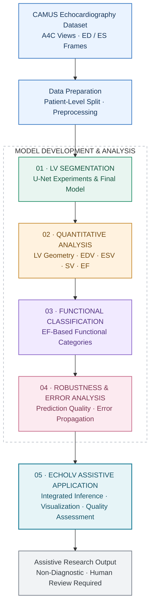

CAMUS-LV-Research
From echocardiographic segmentation to interpretable left-ventricular function assessment
A five-phase computer-vision research pipeline for apical four-chamber (A4C/4CH) echocardiography
LV segmentation · Quantitative geometry · EF-based classification · Reliability analysis · Assistive application
Research internship project — ASCEND Lab, NUST

[!IMPORTANT]
Research prototype — not a medical device. This work is assistive and non-diagnostic. Its estimated measurements and classifications are not clinically validated and must not be used for patient-care decisions.

Overview
Accurate left-ventricular (LV) segmentation is a prerequisite for many automated echocardiography workflows, but a high segmentation Dice score does not guarantee accurate downstream cardiac measurements. Small changes to LV cavity boundaries—particularly at end-systole (ES)—can alter estimated volumes, ejection fraction (EF), and the resulting functional category.
This repository documents a staged investigation of that problem using the CAMUS dataset. Rather than evaluating a segmentation network in isolation, the project follows errors through the full pipeline: LV masks → geometric measurements → estimated EF → EF-based classification → confidence/quality-aware assistive output.
Research focus
1. How do controlled segmentation design choices affect LV mask quality?
2. How do segmentation errors propagate into EDV, ESV, and EF estimates?
3. How reliable is an EF-based classifier when its inputs come from predicted, rather than ground-truth, masks?
4. How can confidence, image-quality limitations, and failure cases be surfaced in a non-diagnostic application?
End-to-end workflow

Dataset and experimental protocol
Item	Project setting
Dataset	CAMUS (Cardiac Acquisitions for Multi-structure Ultrasound Segmentation)
Imaging view	Apical four-chamber (4CH/A4C)
Cardiac phases	End-diastole (ED) and end-systole (ES)
Segmentation target	LV cavity, converted to a binary mask from the CAMUS labels
Patient-level split	400 train / 50 validation / 50 test; seed 42
Evaluation principle	Validation-guided development; held-out patient test set for final reporting
Development environment	Primarily Python, TensorFlow/Keras, Google Colab; downstream analysis with scientific Python tools

Patient-level splitting matters because ED and ES frames from the same person must not leak across training and evaluation partitions. The project’s split manifests are in [`CAMUS_FINAL/splits/`](CAMUS_FINAL/splits/).
Dataset origin, access, and attribution
The dataset used for these experiments was downloaded from a Kaggle-hosted CAMUS copy, rather than directly from the original project website:
- Download source used: CAMUS-Human Heart Data — Kaggle, uploaded by shoybhasan
- Original dataset and project: CAMUS — CREATIS / University of Lyon
- Original publication: Leclerc et al. (2019), Deep Learning for Segmentation Using an Open Large-Scale Dataset in 2D Echocardiography, IEEE Transactions on Medical Imaging, 38(9), 2198–2210. DOI: 10.1109/TMI.2019.2900516
Important distinction: Kaggle is the download location for this project, not the original creator or scientific publisher of CAMUS. The original CAMUS work must still be cited. The 400/50/50 patient-level partition (seed 42) is a project-specific split, not the original CAMUS challenge's default partition. See the committed [split manifests](CAMUS_FINAL/splits/) for the exact patient assignment.
Data availability and rights: Raw CAMUS scans are not redistributed in this repository. Anyone reproducing the experiments should obtain the data from a source they are authorized to use, check the dataset's current usage terms, and independently verify that the Kaggle copy corresponds to the expected CAMUS version. Patient-level analysis tables and notebook outputs should also be reviewed for permitted redistribution before any public release.
Research phases
Phase 1 — Controlled LV segmentation experiments
Goal: Build and select an LV segmentation model while separating the effects of resolution, training settings, network capacity, and loss formulation.
Subphase	Investigation	Primary evidence
1A — Resolution	128×128 vs. 256×256 vs. 512×512	[Notebook](CAMUS_FINAL/phase1_segmentation/phase1A_resolution/code/Phase1A_Clean_Baseline_and_Resolution.ipynb) · [Comparison table](CAMUS_FINAL/phase1_segmentation/phase1A_resolution/tables/phase1A_resolution_comparison.csv)
1B — Hyperparameters	Learning rate, optimizer, batch size, augmentation	[Experiments](CAMUS_FINAL/phase1_segmentation/phase1B_hyperparameters/code/)
1C — Capacity	Small, medium, and large U-Net variants	[Notebook](CAMUS_FINAL/phase1_segmentation/phase1C_capacity/code/Phase1C_Clean_Model_Capacity_Experiment.ipynb)
1D — Loss	BCE + Dice, Focal + Dice, Tversky	[Notebook](CAMUS_FINAL/phase1_segmentation/phase1D_loss/code/Phase1D_Clean_Loss_Function_Experiment.ipynb)
1E — Final validation	Locked segmentation evaluation and ED/ES error review	[Notebook](CAMUS_FINAL/phase1_segmentation/phase1E_final_validation/code/Phase1E_Final_Segmentation_Validation.ipynb) · [Test summary](CAMUS_FINAL/phase1_segmentation/phase1E_final_validation/tables/final_test_summary.csv)
1F — Model freeze	Prepare selected segmentation model for downstream use	[Notebook](CAMUS_FINAL/phase1_segmentation/phase1F_final_model/code/Phase1F_Freeze_Final_Segmentation_Model.ipynb)

The research selected a 256×256 large U-Net segmentation configuration for downstream work, with validation-guided comparisons of alternative settings. See the committed configuration and evaluation records for the final frozen experiment's exact parameters and results.
Why it matters: Dice/IoU measure overlap, but errors in the LV boundary can have different consequences at ED and ES. This motivates the measurement-level evaluation in Phase 2.
Phase 2 — Quantitative LV analysis
Goal: Convert ED/ES masks into estimated LV geometry and evaluate the impact of segmentation errors.
The pipeline includes mask post-processing, LV cavity area and long-axis measurements, geometric volume approximation, and derived quantities:
\[
SV = EDV - ESV, \qquad EF(\%) = \frac{EDV - ESV}{EDV}\times100.
\]
Here EDV and ESV are estimated end-diastolic and end-systolic volumes, and SV is estimated stroke volume. These values depend on the chosen single-view geometric assumptions; they are not interchangeable with clinically established volumetric measurements.
- [Phase 2A — Measurement methodology](CAMUS_FINAL/phase2_quantitative/phase2A_measurement_method/code/Phase2A_LV_Quantitative_Analysis.ipynb)
- [Phase 2B — Final quantitative evaluation](CAMUS_FINAL/phase2_quantitative/phase2B_final_evaluation/code/Phase2B_Final_Quantitative_Evaluation (1\).ipynb)
- [Held-out quantitative results](CAMUS_FINAL/phase2_quantitative/phase2B_final_evaluation/tables/final_test_quantitative_measurements.csv)
- [ED vs. ES error comparison](CAMUS_FINAL/phase2_quantitative/phase2B_final_evaluation/tables/final_test_ED_vs_ES_quantitative_error.csv)
- [EF error decomposition](CAMUS_FINAL/phase2_quantitative/phase2B_final_evaluation/tables/final_test_EF_error_decomposition.csv)
Phase 3 — EF-based functional classification
Goal: Evaluate whether derived quantitative measurements support meaningful EF-band classification, and compare a direct rule-based baseline with a learned classifier.
Component	Description	Source
Label audit	Definition and distribution of EF-based classes	[Phase 3A](CAMUS_FINAL/phase3_classification/phase3A_label_audit/code/Phase3A_EF_Classification_Design_and_Label_Audit.ipynb)
Direct baseline	Classification using estimated geometry/EF	[Phase 3B](CAMUS_FINAL/phase3_classification/phase3B_direct_baseline/code/Phase3B_Direct_Geometry_Classification_Baseline.ipynb)
Learned model	Feature-based classifier development and validation	[Phase 3C](CAMUS_FINAL/phase3_classification/phase3C_classifier_development/code/Phase3C_Learned_Classifier_Development.ipynb)
Locked evaluation	Held-out evaluation, confusion matrix, and per-class performance	[Phase 3D](CAMUS_FINAL/phase3_classification/phase3D_final_evaluation/code/Phase3D_Final_Locked_Evaluation.ipynb)

The project investigates three EF bands: lower (≤40%), intermediate (40–50%), and higher (≥50%). The [label-audit notebook](CAMUS_FINAL/phase3_classification/phase3A_label_audit/code/Phase3A_EF_Classification_Design_and_Label_Audit.ipynb) is authoritative for how shared boundaries are handled in the implementation.
Reported result: The selected logistic-regression-based classifier achieved 70% test accuracy and 0.663 macro-F1 in the project's later Phase 3 evaluation. Consult the [final per-class metrics](CAMUS_FINAL/phase3_classification/phase3D_final_evaluation/tables/phase3D_final_per_class_metrics.csv) and [confusion matrix](CAMUS_FINAL/phase3_classification/phase3D_final_evaluation/tables/phase3D_final_confusion_matrix.csv) for class-level context. These figures describe the evaluated research split, not clinical generalization.
Phase 4 — Robustness, uncertainty, and failure analysis
Goal: Go beyond aggregate accuracy to understand when and why the full pipeline is unreliable.
- 4A — Error propagation: Trace how ED/ES segmentation differences affect geometric estimates, EF, and final class predictions. [Notebook](CAMUS_FINAL/phase4_robustness/phase4A_error_propagation/code/Phase4A_End_to_End_Error_Propagation.ipynb)
- 4B — Confidence and uncertainty: Inspect classification confidence, including confident errors and low-confidence correct predictions. [Notebook](CAMUS_FINAL/phase4_robustness/phase4B_confidence_uncertainty/code/Phase4B_Confidence_and_Uncertainty_Analysis.ipynb)
- 4C — Image-quality subgroups: Compare outcomes across CAMUS image-quality categories. [Notebook](CAMUS_FINAL/phase4_robustness/phase4C_image_quality_subgroups/code/Phase4C_Image_Quality_and_Failure_Subgroups.ipynb)
- 4D — Representative failures: Examine selected failure cases and their reproducibility. [Notebook](CAMUS_FINAL/phase4_robustness/phase4D_representative_failure_cases/code/Phase4D_Representative_Failure_Cases (1\).ipynb)
Central research insight: Strong pixel-level segmentation overlap does not automatically translate into reliable EF estimation. Errors at ES, where the cavity is smaller, can be especially consequential for derived volumes and EF. The repository preserves case-level analyses so this conclusion can be investigated rather than asserted solely from a headline metric.
Phase 5 — Assistive application and verification
Goal: Integrate frozen research components into an interpretable, non-diagnostic workflow and verify the behavior of its outputs.
Subphase	Scope	Artifacts
5A	Input/output contracts, architecture, and warning design	[System specifications](CAMUS_FINAL/phase5_application/phase5A_system_specification/configs/)
5B	Integrated frozen pipeline and measurement consistency checks	[Verification](CAMUS_FINAL/phase5_application/phase5B_integrated_pipeline/verification/)
5C	Assistive application implementation and demonstration	[Application code](CAMUS_FINAL/phase5_application/phase5C_assistive_application/app/)
5D	Input validation, numerical consistency, error handling, regression checks	[Verification report](CAMUS_FINAL/phase5_application/phase5D_final_verification/reports/PHASE5_FINAL_VERIFICATION_REPORT.txt)
5E	Quality checks, EF interpretation, and case review	[Quality-analysis artifacts](CAMUS_FINAL/phase5_application/phase5E_quality_and_interpretation/)

Application entry points: [`app.py`](CAMUS_FINAL/phase5_application/EchoLV_Deployment/app.py), [`echolv_app.py`](CAMUS_FINAL/phase5_application/EchoLV_Deployment/echolv_app.py), [`frozen_inference.py`](CAMUS_FINAL/phase5_application/EchoLV_Deployment/frozen_inference.py), and the [Colab launcher](CAMUS_FINAL/phase5_application/EchoLV_Deployment/ASCEND_EchoLV_Launcher.ipynb). The [Phase 5 notebooks](CAMUS_FINAL/phase5_application/phase5_Application_Code_Files/) document the development work.
The intended assistive output combines segmentation/measurement results with EF-band interpretation and reliability or quality warnings. Presence of verification files does not imply clinical validation or a production deployment.
Selected findings and evidence
Finding	Evidence / interpretation
Segmentation was studied through controlled comparisons	Resolution, hyperparameters, capacity, and loss experiments are preserved with protocols and result tables in [Phase 1](CAMUS_FINAL/phase1_segmentation/).
Downstream error matters independently of Dice	[Phase 2 error decomposition](CAMUS_FINAL/phase2_quantitative/phase2B_final_evaluation/tables/final_test_EF_error_decomposition.csv) examines effects on EF, not only mask overlap.
Classification remains imperfect	70% test accuracy, 0.663 macro-F1 for the selected Phase 3 classifier; inspect the [locked evaluation](CAMUS_FINAL/phase3_classification/phase3D_final_evaluation/).
Confidence is not a guarantee of correctness	[Phase 4B](CAMUS_FINAL/phase4_robustness/phase4B_confidence_uncertainty/) includes confidence/error comparisons and confident misclassification review.
Quality and representative failures deserve explicit reporting	[Phase 4C](CAMUS_FINAL/phase4_robustness/phase4C_image_quality_subgroups/) and [4D](CAMUS_FINAL/phase4_robustness/phase4D_representative_failure_cases/) examine subgroups and failure cases.

Metric provenance: This summary intentionally avoids mixing early baseline experiments with later selected-model evaluations. For final segmentation Dice/IoU and geometric error magnitudes, use the corresponding locked final evaluation tables rather than an earlier notebook's best validation score. Results should be independently checked against the committed CSV/JSON records before publication or citation.

Repository structure
CAMUS-LV-Research/
├── README.md
├── .gitignore
├── .gitattributes
└── CAMUS_FINAL/
    ├── configs/                  # Shared experiment configuration
    ├── splits/                   # Patient-level split manifests
    ├── phase1_segmentation/      # Segmentation experiments, evaluation, freeze
    ├── phase2_quantitative/      # LV geometry and EF analysis
    ├── phase3_classification/    # EF-band baselines and classifier
    ├── phase4_robustness/        # Error, confidence, quality, failure cases
    └── phase5_application/       # Integration, application, verification
        ├── EchoLV_Deployment/
        └── phase5_Application_Code_Files/
Subphase directories typically contain code/, configs/, tables/, plots/, histories/, or verification/. Some output directories and binary artifacts are deliberately excluded from Git.
Getting started and reproducibility
1. Clone the repository
git clone https://github.com/ayeshacheema/CAMUS-LV-Research.git
cd CAMUS-LV-Research
The repository is currently private. Cloning requires access granted by its owner.

2. Obtain the data and review the split
Download CAMUS from an authorized source. The version used for this project was obtained from the Kaggle CAMUS-Human Heart Data page; consult the original CAMUS project for provenance and research citation. Use the committed [`splits/`](CAMUS_FINAL/splits/) manifests to understand the research's patient-level separation; do not generate a new random split and compare the resulting numbers as if they were identical experiments.
3. Choose a phase and prepare its environment
Most research notebooks were developed in Google Colab and use Google Drive paths such as /content/drive. Review and replace these paths before execution. Install the dependencies actually imported by the selected notebook; the deployment-specific requirements are in [`EchoLV_Deployment/requirements.txt`](CAMUS_FINAL/phase5_application/EchoLV_Deployment/requirements.txt).
4. Reproduce in dependency order
CAMUS preparation + patient split
  -> Phase 1 frozen segmentation model
  -> Phase 2 geometric measurements
  -> Phase 3 classifier
  -> Phase 4 analysis
  -> Phase 5 integrated application
Important limitations: Trained .keras/.h5 checkpoints, .joblib model artifacts where applicable, .npy/.npz arrays, raw .nii/.nii.gz scans, and local case databases are not guaranteed to be available in the GitHub repository. Full reproduction may require retraining, regenerating intermediate artifacts, and updating notebook paths. This repository is a research record, not a one-command installation or hosted clinical service.
Limitations and responsible use
- Single-view approximation: EF estimates are derived from the project's 4CH geometric workflow; they should not be equated with clinically validated volumetric EF.
- Error propagation: Segmentation, measurement, and classification errors compound across stages.
- Dataset scope: Evaluation is limited to the recorded CAMUS partitions and study design; external validation is not established here.
- Confidence and quality: Prediction scores and quality flags help contextualize outputs but do not guarantee reliability.
- Privacy and permissions: Before public release, audit notebooks, saved outputs, figures, per-patient CSVs, embedded identifiers, file paths, and data/model redistribution permissions. CAMUS-derived material may have usage conditions.
- Medical safety: No diagnosis, treatment advice, or patient-care use.
Project provenance and acknowledgment
This research was developed during a computer-vision research internship at ASCEND Lab, National University of Sciences and Technology (NUST), Pakistan. The work builds on the CAMUS dataset and relevant research in echocardiographic segmentation and LV functional analysis.
Dataset citation: Leclerc, S., et al. (2019). Deep Learning for Segmentation Using an Open Large-Scale Dataset in 2D Echocardiography. IEEE Transactions on Medical Imaging, 38(9), 2198–2210. DOI: 10.1109/TMI.2019.2900516. Downloaded from: Kaggle — CAMUS-Human Heart Data.
The dataset creators, internship lab, and any adopted external code or methods should receive attribution consistent with their respective terms. This repository does not claim clinical validation or a peer-reviewed publication of the pipeline.
License
No license is currently granted by this repository. All rights are reserved unless a license is explicitly added. CAMUS data and third-party components retain their own terms. Contact the repository owner for permission before reusing project-specific code or materials.
